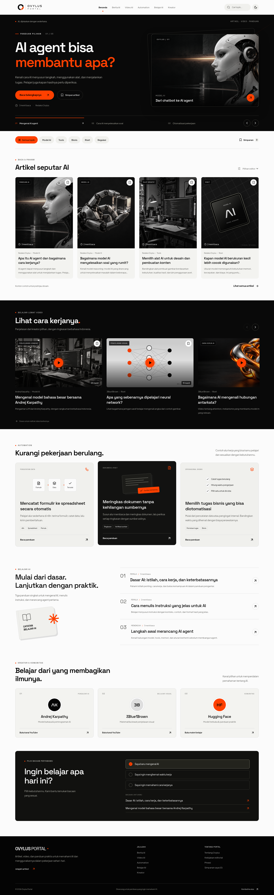
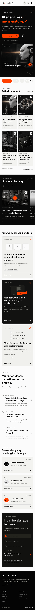
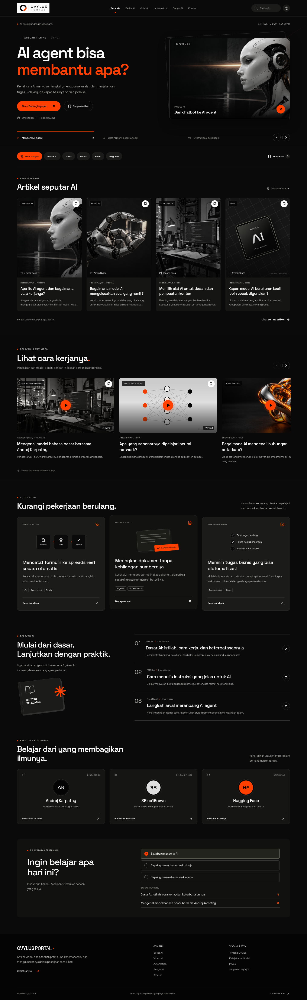

# Ovylus Portal

Homepage interaktif portal media AI berbahasa Indonesia. Identitas visual menggabungkan struktur katalog sinematik dengan gaya editorial KINETIC: putih, hitam, abu-abu, dan oranye `#FF4000`.

## Pratinjau desain

Screenshot hasil aplikasi dapat dilihat langsung di GitHub:

- [Desktop — tema terang](docs/previews/desktop.png)
- [Mobile — tema terang](docs/previews/mobile.png)
- [Desktop — tema gelap](docs/previews/dark.png)

<details>
<summary>Lihat tampilan desktop</summary>



</details>

<details>
<summary>Lihat tampilan mobile</summary>



</details>

<details>
<summary>Lihat tema gelap</summary>



</details>

Screenshot ini merupakan pratinjau visual. Untuk mencoba interaksi, jalankan aplikasi mengikuti panduan di bawah; website belum di-deploy ke hosting.

Catatan penggabungan referensi dan bahasa antarmuka: [Keputusan desain](docs/design-notes.md).

## Menjalankan

Gunakan Node.js 22.12+ (divalidasi dengan Node.js 24) dan npm.

```bash
npm ci
npm run dev
```

Vite memakai port 5173 secara default. Untuk build produksi:

```bash
npm run build
npm run preview
```

Output statis berada di `dist/` dan dapat diterbitkan pada hosting statis. Deployment belum dikonfigurasi.

## Fitur

- Homepage responsif dengan enam menu dan carousel pilihan editor.
- Pencarian lintas kategori, filter topik, urutan judul, dan kondisi hasil kosong.
- Detail artikel dalam dialog dengan navigasi keyboard dan pemulihan fokus.
- Simpan konten serta tema terang/gelap yang bertahan di browser melalui `localStorage`.
- Kurasi video; pemutar YouTube dimuat hanya setelah pengguna menekan putar.
- Bagian automation, panduan belajar, kreator, dan informasi editorial/privasi.
- Deretan video yang dapat digeser dengan tombol, sentuhan, atau trackpad.
- Pilihan kebutuhan belajar yang menampilkan rekomendasi bacaan terkait.
- Transisi masuk bagian halaman, respons hover poster, gerakan ringan pada gambar hero, serta animasi bookmark dan diagram.
- Dukungan `prefers-reduced-motion`, skip link, dan indikator fokus.

## Konten dan aset

- `src/data.ts`: contoh artikel, ringkasan, sumber, dan daftar kreator. Konten contoh diberi label dan tidak diposisikan sebagai berita terkini.
- `src/App.tsx`: komponen dan interaksi homepage.
- `src/styles.css`: desain responsif dan kedua tema.
- `public/images/ovylus-logo.png` dan `public/favicon.png`: salinan aset merek yang tersedia di repository. Commit `01acb3b` berjudul “logo terbaru” memiliki tree yang sama dengan commit sebelumnya.
- `public/images/`: logo serta ilustrasi editorial robot, tangan mekanis, ruang kerja, dan bentuk krom. Ilustrasi dibuat dengan AI untuk desain ini; bukan foto dokumentasi peristiwa atau orang tertentu.
- `public/fonts/`: Nasalization dan CCMetcon dari aset repository, Nasalization dipakai pada monogram; berkas CCMetcon tetap tersedia. Font utama mengikuti referensi baru: Space Grotesk untuk judul dan Plus Jakarta Sans untuk teks. Keduanya disediakan lokal melalui paket `@fontsource-variable`.

Tidak ada backend, akun, API berita, atau kredensial yang diperlukan. Simpanan hanya berada di perangkat pengguna. Pemutaran video dan sumber eksternal memerlukan internet; ketersediaan video mengikuti YouTube. Tautan kreator mengarah ke kanal asli.

## Pengujian

```bash
npx playwright install chromium
npm test
```

Jika Chromium sudah tersedia di sistem (seperti pada cloud environment ini):

```bash
PLAYWRIGHT_CHROMIUM_EXECUTABLE_PATH=/usr/bin/chromium npm test
```

Playwright menjalankan skenario desktop dan mobile untuk aset, error runtime, overflow, tema, carousel, dialog, pencarian, filter, bookmark, navigasi, reset privasi, kontrol video, rekomendasi belajar, gerakan pointer, dan reduced motion. Pengujian embed memalsukan respons YouTube untuk memeriksa pemuatan atas tindakan pengguna; pengujian ini tidak menyatakan bahwa playback eksternal telah diverifikasi.

## Cloud environment

Checkout berada di `/workspace/Ovylus-Portal`. Gunakan checkout yang ada; setiap task sudah terisolasi, sehingga tidak perlu membuat Git worktree kecuali diminta.

Dependensi dapat dipulihkan dengan `npm ci --no-audit --no-fund`. Jalankan dev server dengan `npm run dev -- --port 5173 --strictPort`. Proses server perlu dimulai lagi setelah pemulihan environment. Jangan mengandalkan proses dari sesi sebelumnya tetap hidup.

Folder `node_modules`, `dist`, cache npm lokal, serta hasil Playwright diabaikan oleh Git. Tidak ada rahasia yang perlu ditambahkan.
